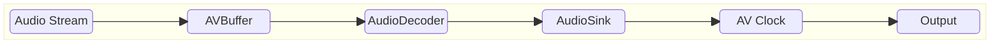
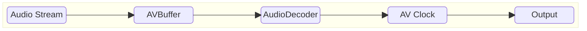
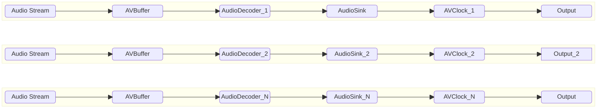
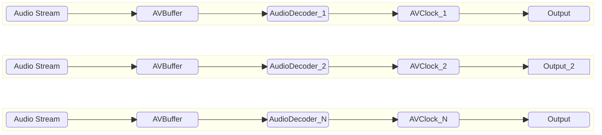
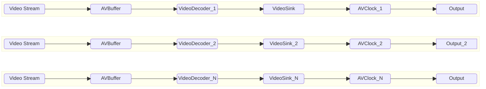
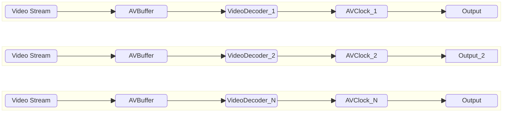

# AV Clock Level 3 High Level Test Specification Document

## Table of Contents

- [Acronyms, Terms and Abbreviations](#acronyms-terms-and-abbreviations)
- [Introduction](#introduction)
- [Module Description](#module-description)
- [Test Frame Specifications](#test-frame-specifications)
- [L3 Test Specification](#l3-test-specification)

## Acronyms, Terms and Abbreviations

- `HAL`    - Hardware Abstraction Layer
- `API`    - Application Programming Interface
- `L3`     - Level 3 Testing
- `NA`     - Not Applicable
- `Y`      - Yes
- `CB`     - Call-back function (suffix)
- `RDK`    - Reference Design Kit
- `EOS`    - End Of Stream
- `PCR`    - Program Clock Reference

## Introduction

This document provides an overview of the testing requirements for the AV Clock module. It outlines the scope of testing, objectives, testing levels and approaches, specific test requirements, and expected deliverables.

- AV Clock Interface Definitions - [AV Clock HAL](https://github.com/rdkcentral/rdk-halif-aidl/tree/0.7.1/avclock/current/com/rdk/hal/avclock)

- AV Clock Overview - [AV Clock Overview](https://wiki.rdkcentral.com/display/RDKHAL/AV+Clock)

## Module Description

The AV Clock HAL service links audio sinks and video sinks together to provide lip sync playback against a shared clock.

The audio and video sinks that are linked by an AV Clock form a sync group which share a common clock for presentation.

The AV Clock HAL allows the application to specify which video sink and audio sink(s) are linked in the sync group.

## Test Streams Specification

- Test Config File - [Test Config File](https://github.com/rdkcentral/rdk-halif-binder-test-avclock/blob/feature/gh8_avclock_l3_hld/test_configuration/vts_l3_test_config.yaml)

## L3 Test Specification

### Prerequisites

#### AV Buffer

Audio frames , Video frames are supplied to the Audio Decoder , Video Decoder  during testing on AV Clock, which necessitates a pre-validated AVBuffer module. Therefore, the AVBuffer must successfully pass VTS L1, L2, and L3 testing before being used in the Audio Decoder tests.

### Audio Decoder 

Audio frames are supplied to the Audio Decoder for both tunnel , non-tunnel mode during testing on AV Clock, which necessitates a pre-validated Audio Decoder module. Therefore, the AudioDecoder must successfully pass VTS L1, L2, and L3 testing before being used in the AV Clock tests.

### Video Decoder

Video frames are supplied to the Video Decoder for both tunnel, non-tunnel mode during testing on AV Clock, which necessitates a pre-validated Video Decoder module. Therefore, the VideoDecoder must successfully pass VTS L1, L2, and L3 testing before being used in the AV Clock tests.

### Audio Sink

Decoded Audio frames are supplied to the Audio Sink during testing for non tunnel cases, which necessitates a pre-validated Audio Sink module. Therefore, the AudioSink must successfully pass VTS L1, L2, and L3 testing before being used in the AV Clock tests.

### Video Sink

Decoded Video frames are supplied to the Video Sink during testing for non tunnel cases, which necessitates a pre-validated Video Sink module. Therefore, the VideoSink must successfully pass VTS L1, L2, and L3 testing before being used in the AV Clock tests.

### Feature List

VTS L3 validates all the AV Clock features in both sequential and concurrent  modes (if the platform supports multiple AV Clock instances) as represented below.

### Sequential Clock Priming

The Sequential AV Clock test evaluates each AV Clock individually in tunnel and non tunnel mode, one after another, to ensure functional correctness across all supported features. This approach helps isolate issues and verify that every AV Clock instance performs as expected in a standalone environment.

#### Non Tunnel Audio Stream

#### Non Tunnel Video Stream

#### Tunnel Audio Stream

#### Tunnel Video Stream

### Concurrent Clock Priming

The Concurrent Clocking test assesses the system's ability to handle multiple AV Clock operating simultaneously, each configured with different supported features. This test is designed to validate the robustness, resource management, and feature compatibility of the platform under concurrent load, and is applicable only if the platform supports multiple AV Clock instances.

#### Non Tunnel Audio Stream

#### Tunnel Audio Stream

#### Non Tunnel Video Stream

#### Non Tunnel Video Stream

The following table outlines the core features validated in the L3 test phase

|#|Testing Feature|Description|
|-|---------------|-----------|
|1|Tunnel/Non-Tunnel|Checks the Behavior of  the AV Clock in tunnel and non tunnel mode.In tunnel mode and non tunel mode the AV Clock Primes the clock of the frames provided|
|2|Secure and Non-Secure|AV Clock should prime the clock for secure and non secure frames provided|
|3|AUTO|Clock mode AUTO is the default clock mode after a call to `open()`|
|4|PCR|Clock mode PCR Use PCR samples as the clock source as provided in successive calls to `notifyPCRSample()`|
|5|AUDIO_MASTER|Clock mode AUDIO_MASTER  uses the audio source as the clock master|
|6|VIDEO_MASTER|Clock mode VIDEO_MASTER  uses the video source as the clock master|
|7|Audio Only|Test primes the clock for the audio only streams based on the PTS supplied|
|8|Video Only|Test primes the clock for the video only streams based on the PTS supplied|
|9|Process Audio before Video|Test primes the clock for the audio frames passed before video frames based on the PTS supplied|
|10|Process Video before Audio|Test primes the clock for the video frames passed before audio frames based on the PTS supplied|
|11|Play Back Rate|Test Sets the playback rate for the AV Clock like `0.0` for mute, `1.0` for normal speed and `2.0` for fast forward|
|12|Concurrent Prime Clock|If platform supports multiple AV Clock instances, test executes multiple AV Clock instances simultaneously, Priming clock based on the PTS supplied|

### Test Cases

The table below summarizes the L3 test cases executed using various audio stream formats and configurations. These tests are also executed in a multi-process environment:

|#|Test|Tunnel|Secure|Auto|PCR|AudioMaster|VideoMaster|AudioOnly|VideoOnly|AudioBeforeVideo|VideoBeforeAudio|PlayBackRate|Concurrency|
|-|----|------|------|----|---|-----------|-----------|---------|---------|----------------|----------------|------------|-----------|
|1|PrimeClock_Sequential_NonTunnel_NonSecure_AutoAudioOnly|✘|✘|✔|✘|✘|✘|✔|✘|✘|✘|✘|✘|
|2|PrimeClock_Sequential_NonTunnel_NonSecure_AutoVideoOnly|✘|✘|✔|✘|✘|✘|✘|✔|✘|✘|✘|✘|
|3|PrimeClock_Sequential_NonTunnel_NonSecure_AudioMasterAudioOnly|✘|✘|✘|✘|✔|✘|✔|✘|✘|✘|✘|✘|
|4|PrimeClock_Sequential_NonTunnel_NonSecure_VideoMasterVideoOnly|✘|✘|✘|✘|✘|✔|✘|✔|✘|✘|✘|✘|
|5|PrimeClock_Sequential_NonTunnel_NonSecure_AudioMasterVideoOnly|✘|✘|✘|✘|✔|✘|✘|✔|✘|✘|✘|✘|
|6|PrimeClock_Sequential_NonTunnel_NonSecure_VideoMasterAudioOnly|✘|✘|✘|✘|✘|✔|✔|✘|✘|✘|✘|✘|
|7|PrimeClock_Sequential_NonTunnel_NonSecure_PCRMode|✘|✘|✘|✔|✘|✘|✘|✘|✘|✘|✘|✘|
|8|PrimeClock_Sequential_NonTunnel_NonSecure_AutoAudioBeforeVideo|✘|✘|✔|✘|✘|✘|✘|✘|✔|✘|✘|✘|
|9|PrimeClock_Sequential_NonTunnel_NonSecure_AutoVideoBeforeAudio|✘|✘|✔|✘|✘|✘|✘|✘|✘|✔|✘|✘|
|10|PrimeClock_Sequential_NonTunnel_NonSecure_SetPlayRateNormalSpeed|✘|✘|✘|✘|✘|✘|✘|✘|✘|✘|✔|✘|
|11|PrimeClock_Sequential_NonTunnel_NonSecure_SetPlayRatePause|✘|✘|✘|✘|✘|✘|✘|✘|✘|✘|✔|✘|
|12|PrimeClock_Sequential_NonTunnel_NonSecure_SetPlayRateFastForward|✘|✘|✘|✘|✘|✘|✘|✘|✘|✘|✔|✘|
|13|PrimeClock_Sequential_NonTunnel_Secure_AutoAudioOnly|✘|✔|✔|✘|✘|✘|✔|✘|✘|✘|✘|✘|
|14|PrimeClock_Sequential_NonTunnel_Secure_AutoVideoOnly|✘|✔|✔|✘|✘|✘|✘|✔|✘|✘|✘|✘|
|15|PrimeClock_Sequential_NonTunnel_Secure_AudioMasterAudioOnly|✘|✔|✘|✘|✔|✘|✔|✘|✘|✘|✘|✘|
|16|PrimeClock_Sequential_NonTunnel_Secure_VideoMasterVideoOnly|✘|✔|✘|✘|✘|✔|✘|✔|✘|✘|✘|✘|
|17|PrimeClock_Sequential_NonTunnel_Secure_AudioMasterVideoOnly|✘|✔|✘|✘|✔|✘|✘|✔|✘|✘|✘|✘|
|18|PrimeClock_Sequential_NonTunnel_Secure_VideoMasterAudioOnly|✘|✔|✘|✘|✘|✔|✔|✘|✘|✘|✘|✘|
|19|PrimeClock_Sequential_NonTunnel_Secure_PCRMode|✘|✔|✘|✔|✘|✘|✘|✘|✘|✘|✘|✘|
|20|PrimeClock_Sequential_NonTunnel_Secure_AutoAudioBeforeVideo|✘|✔|✔|✘|✘|✘|✘|✘|✔|✘|✘|✘|
|21|PrimeClock_Sequential_NonTunnel_Secure_AutoVideoBeforeAudio|✘|✔|✔|✘|✘|✘|✘|✘|✘|✔|✘|✘|
|22|PrimeClock_Sequential_NonTunnel_Secure_SetPlayRateNormalSpeed|✘|✔|✘|✘|✘|✘|✘|✘|✘|✘|✔|✘|
|23|PrimeClock_Sequential_NonTunnel_Secure_SetPlayRatePause|✘|✔|✘|✘|✘|✘|✘|✘|✘|✘|✔|✘|
|24|PrimeClock_Sequential_NonTunnel_Secure_SetPlayRateFastForward|✘|✔|✘|✘|✘|✘|✘|✘|✘|✘|✔|✘|
|25|PrimeClock_Sequential_Tunnel_NonSecure_AutoAudioOnly|✔|✘|✔|✘|✘|✘|✔|✘|✘|✘|✘|✘|
|26|PrimeClock_Sequential_Tunnel_NonSecure_AutoVideoOnly|✔|✘|✔|✘|✘|✘|✘|✔|✘|✘|✘|✘|
|27|PrimeClock_Sequential_Tunnel_NonSecure_AudioMasterAudioOnly|✔|✘|✘|✘|✔|✘|✔|✘|✘|✘|✘|✘|
|28|PrimeClock_Sequential_Tunnel_NonSecure_VideoMasterVideoOnly|✔|✘|✘|✘|✘|✔|✘|✔|✘|✘|✘|✘|
|29|PrimeClock_Sequential_Tunnel_NonSecure_AudioMasterVideoOnly|✔|✘|✘|✘|✔|✘|✘|✔|✘|✘|✘|✘|
|30|PrimeClock_Sequential_Tunnel_NonSecure_VideoMasterAudioOnly|✔|✘|✘|✘|✘|✔|✔|✘|✘|✘|✘|✘|
|31|PrimeClock_Sequential_Tunnel_NonSecure_PCRMode|✔|✘|✘|✔|✘|✘|✘|✘|✘|✘|✘|✘|
|32|PrimeClock_Sequential_Tunnel_NonSecure_AutoAudioBeforeVideo|✔|✘|✔|✘|✘|✘|✘|✘|✔|✘|✘|✘|
|33|PrimeClock_Sequential_Tunnel_NonSecure_AutoVideoBeforeAudio|✔|✘|✔|✘|✘|✘|✘|✘|✘|✔|✘|✘|
|34|PrimeClock_Sequential_Tunnel_NonSecure_SetPlayRateNormalSpeed|✔|✘|✘|✘|✘|✘|✘|✘|✘|✘|✔|✘|
|35|PrimeClock_Sequential_Tunnel_NonSecure_SetPlayRatePause|✔|✘|✘|✘|✘|✘|✘|✘|✘|✘|✔|✘|
|36|PrimeClock_Sequential_Tunnel_NonSecure_SetPlayRateFastForward|✔|✘|✘|✘|✘|✘|✘|✘|✘|✘|✔|✘|
|37|PrimeClock_Sequential_Tunnel_Secure_AutoAudioOnly|✔|✔|✔|✘|✘|✘|✔|✘|✘|✘|✘|✘|
|38|PrimeClock_Sequential_Tunnel_Secure_AutoVideoOnly|✔|✔|✔|✘|✘|✘|✘|✔|✘|✘|✘|✘|
|39|PrimeClock_Sequential_Tunnel_Secure_AudioMasterAudioOnly|✔|✔|✘|✘|✔|✘|✔|✘|✘|✘|✘|✘|
|40|PrimeClock_Sequential_Tunnel_Secure_VideoMasterVideoOnly|✔|✔|✘|✘|✘|✔|✘|✔|✘|✘|✘|✘|
|41|PrimeClock_Sequential_Tunnel_Secure_AudioMasterVideoOnly|✔|✔|✘|✘|✔|✘|✘|✔|✘|✘|✘|✘|
|42|PrimeClock_Sequential_Tunnel_Secure_VideoMasterAudioOnly|✔|✔|✘|✘|✘|✔|✔|✘|✘|✘|✘|✘|
|43|PrimeClock_Sequential_Tunnel_Secure_PCRMode|✔|✔|✘|✔|✘|✘|✘|✘|✘|✘|✘|✘|
|44|PrimeClock_Sequential_Tunnel_Secure_AutoAudioBeforeVideo|✔|✔|✔|✘|✘|✘|✘|✘|✔|✘|✘|✘|
|45|PrimeClock_Sequential_Tunnel_Secure_AutoVideoBeforeAudio|✔|✔|✔|✘|✘|✘|✘|✘|✘|✔|✘|✘|
|46|PrimeClock_Sequential_Tunnel_Secure_SetPlayRateNormalSpeed|✔|✔|✘|✘|✘|✘|✘|✘|✘|✘|✔|✘|
|47|PrimeClock_Sequential_Tunnel_Secure_SetPlayRatePause|✔|✔|✘|✘|✘|✘|✘|✘|✘|✘|✔|✘|
|48|PrimeClock_Sequential_Tunnel_Secure_SetPlayRateFastForward|✔|✔|✘|✘|✘|✘|✘|✘|✘|✘|✔|✘|
|49|PrimeClock_Concurrent_NonTunnel_NonSecure_AutoAudioOnly|✘|✘|✔|✘|✘|✘|✔|✘|✘|✘|✘|✔|
|50|PrimeClock_Concurrent_NonTunnel_NonSecure_AutoVideoOnly|✘|✘|✔|✘|✘|✘|✘|✔|✘|✘|✘|✔|
|51|PrimeClock_Concurrent_NonTunnel_NonSecure_AudioMasterAudioOnly|✘|✘|✘|✘|✔|✘|✔|✘|✘|✘|✘|✔|
|52|PrimeClock_Concurrent_NonTunnel_NonSecure_VideoMasterVideoOnly|✘|✘|✘|✘|✘|✔|✘|✔|✘|✘|✘|✔|
|53|PrimeClock_Concurrent_NonTunnel_NonSecure_AudioMasterVideoOnly|✘|✘|✘|✘|✔|✘|✘|✔|✘|✘|✘|✔|
|54|PrimeClock_Concurrent_NonTunnel_NonSecure_VideoMasterAudioOnly|✘|✘|✘|✘|✘|✔|✔|✘|✘|✘|✘|✔|
|55|PrimeClock_Concurrent_NonTunnel_NonSecure_PCRMode|✘|✘|✘|✔|✘|✘|✘|✘|✘|✘|✘|✔|
|56|PrimeClock_Concurrent_NonTunnel_NonSecure_AutoAudioBeforeVideo|✘|✘|✔|✘|✘|✘|✘|✘|✔|✘|✘|✔|
|57|PrimeClock_Concurrent_NonTunnel_NonSecure_AutoVideoBeforeAudio|✘|✘|✔|✘|✘|✘|✘|✘|✘|✔|✘|✔|
|58|PrimeClock_Concurrent_NonTunnel_NonSecure_SetPlayRateNormalSpeed|✘|✘|✘|✘|✘|✘|✘|✘|✘|✘|✔|✔|
|59|PrimeClock_Concurrent_NonTunnel_NonSecure_SetPlayRatePause|✘|✘|✘|✘|✘|✘|✘|✘|✘|✘|✔|✔|
|60|PrimeClock_Concurrent_NonTunnel_NonSecure_SetPlayRateFastForward|✘|✘|✘|✘|✘|✘|✘|✘|✘|✘|✔|✔|
|61|PrimeClock_Concurrent_NonTunnel_Secure_AutoAudioOnly|✘|✔|✔|✘|✘|✘|✔|✘|✘|✘|✘|✔|
|62|PrimeClock_Concurrent_NonTunnel_Secure_AutoVideoOnly|✘|✔|✔|✘|✘|✘|✘|✔|✘|✘|✘|✔|
|63|PrimeClock_Concurrent_NonTunnel_Secure_AudioMasterAudioOnly|✘|✔|✘|✘|✔|✘|✔|✘|✘|✘|✘|✔|
|64|PrimeClock_Concurrent_NonTunnel_Secure_VideoMasterVideoOnly|✘|✔|✘|✘|✘|✔|✘|✔|✘|✘|✘|✔|
|65|PrimeClock_Concurrent_NonTunnel_Secure_AudioMasterVideoOnly|✘|✔|✘|✘|✔|✘|✘|✔|✘|✘|✘|✔|
|66|PrimeClock_Concurrent_NonTunnel_Secure_VideoMasterAudioOnly|✘|✔|✘|✘|✘|✔|✔|✘|✘|✘|✘|✔|
|67|PrimeClock_Concurrent_NonTunnel_Secure_PCRMode|✘|✔|✘|✔|✘|✘|✘|✘|✘|✘|✘|✔|
|68|PrimeClock_Concurrent_NonTunnel_Secure_AutoAudioBeforeVideo|✘|✔|✔|✘|✘|✘|✘|✘|✔|✘|✘|✔|
|69|PrimeClock_Concurrent_NonTunnel_Secure_AutoVideoBeforeAudio|✘|✔|✔|✘|✘|✘|✘|✘|✘|✔|✘|✔|
|70|PrimeClock_Concurrent_NonTunnel_Secure_SetPlayRateNormalSpeed|✘|✔|✘|✘|✘|✘|✘|✘|✘|✘|✔|✔|
|71|PrimeClock_Concurrent_NonTunnel_Secure_SetPlayRatePause|✘|✔|✘|✘|✘|✘|✘|✘|✘|✘|✔|✔|
|72|PrimeClock_Concurrent_NonTunnel_Secure_SetPlayRateFastForward|✘|✔|✘|✘|✘|✘|✘|✘|✘|✘|✔|✔|
|73|PrimeClock_Concurrent_Tunnel_NonSecure_AutoAudioOnly|✔|✘|✔|✘|✘|✘|✔|✘|✘|✘|✘|✔|
|74|PrimeClock_Concurrent_Tunnel_NonSecure_AutoVideoOnly|✔|✘|✔|✘|✘|✘|✘|✔|✘|✘|✘|✔|
|75|PrimeClock_Concurrent_Tunnel_NonSecure_AudioMasterAudioOnly|✔|✘|✘|✘|✔|✘|✔|✘|✘|✘|✘|✔|
|76|PrimeClock_Concurrent_Tunnel_NonSecure_VideoMasterVideoOnly|✔|✘|✘|✘|✘|✔|✘|✔|✘|✘|✘|✔|
|77|PrimeClock_Concurrent_Tunnel_NonSecure_AudioMasterVideoOnly|✔|✘|✘|✘|✔|✘|✘|✔|✘|✘|✘|✔|
|78|PrimeClock_Concurrent_Tunnel_NonSecure_VideoMasterAudioOnly|✔|✘|✘|✘|✘|✔|✔|✘|✘|✘|✘|✔|
|79|PrimeClock_Concurrent_Tunnel_NonSecure_PCRMode|✔|✘|✘|✔|✘|✘|✘|✘|✘|✘|✘|✔|
|80|PrimeClock_Concurrent_Tunnel_NonSecure_AutoAudioBeforeVideo|✔|✘|✔|✘|✘|✘|✘|✘|✔|✘|✘|✔|
|81|PrimeClock_Concurrent_Tunnel_NonSecure_AutoVideoBeforeAudio|✔|✘|✔|✘|✘|✘|✘|✘|✘|✔|✘|✔|
|82|PrimeClock_Concurrent_Tunnel_NonSecure_SetPlayRateNormalSpeed|✔|✘|✘|✘|✘|✘|✘|✘|✘|✘|✔|✔|
|83|PrimeClock_Concurrent_Tunnel_NonSecure_SetPlayRatePause|✔|✘|✘|✘|✘|✘|✘|✘|✘|✘|✔|✔|
|84|PrimeClock_Concurrent_Tunnel_NonSecure_SetPlayRateFastForward|✔|✘|✘|✘|✘|✘|✘|✘|✘|✘|✔|✔|
|85|PrimeClock_Concurrent_Tunnel_Secure_AutoAudioOnly|✔|✔|✔|✘|✘|✘|✔|✘|✘|✘|✘|✔|
|86|PrimeClock_Concurrent_Tunnel_Secure_AutoVideoOnly|✔|✔|✔|✘|✘|✘|✘|✔|✘|✘|✘|✔|
|87|PrimeClock_Concurrent_Tunnel_Secure_AudioMasterAudioOnly|✔|✔|✘|✘|✔|✘|✔|✘|✘|✘|✘|✔|
|88|PrimeClock_Concurrent_Tunnel_Secure_VideoMasterVideoOnly|✔|✔|✘|✘|✘|✔|✘|✔|✘|✘|✘|✔|
|89|PrimeClock_Concurrent_Tunnel_Secure_AudioMasterVideoOnly|✔|✔|✘|✘|✔|✘|✘|✔|✘|✘|✘|✔|
|90|PrimeClock_Concurrent_Tunnel_Secure_VideoMasterAudioOnly|✔|✔|✘|✘|✘|✔|✔|✘|✘|✘|✘|✔|
|91|PrimeClock_Concurrent_Tunnel_Secure_PCRMode|✔|✔|✘|✔|✘|✘|✘|✘|✘|✘|✘|✔|
|92|PrimeClock_Concurrent_Tunnel_Secure_AutoAudioBeforeVideo|✔|✔|✔|✘|✘|✘|✘|✘|✔|✘|✘|✔|
|93|PrimeClock_Concurrent_Tunnel_Secure_AutoVideoBeforeAudio|✔|✔|✔|✘|✘|✘|✘|✘|✘|✔|✘|✔|
|94|PrimeClock_Concurrent_Tunnel_Secure_SetPlayRateNormalSpeed|✔|✔|✘|✘|✘|✘|✘|✘|✘|✘|✔|✔|
|95|PrimeClock_Concurrent_Tunnel_Secure_SetPlayRatePause|✔|✔|✘|✘|✘|✘|✘|✘|✘|✘|✔|✔|
|96|PrimeClock_Concurrent_Tunnel_Secure_SetPlayRateFastForward|✔|✔|✘|✘|✘|✘|✘|✘|✘|✘|✔|✔|